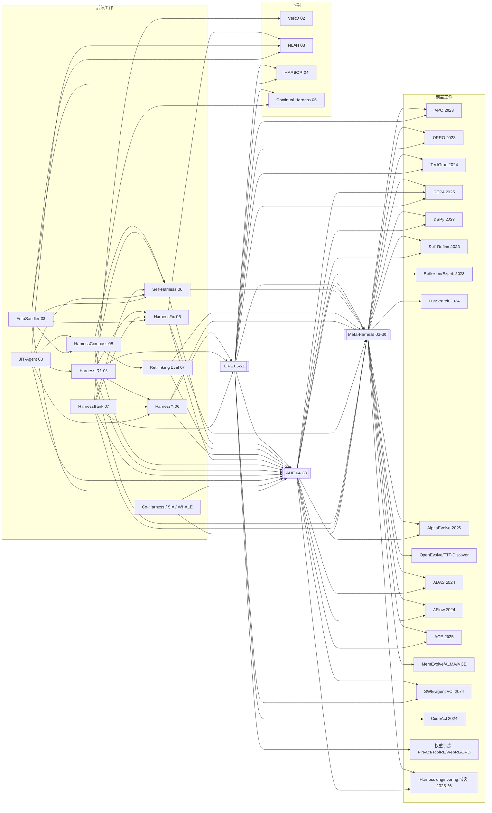

# Harness 自动优化：文献谱系与研究框架

> 三篇种子论文
> - **MH**：Meta-Harness: End-to-End Optimization of Model Harnesses（Lee, …, Khattab, Finn；arXiv:2603.28052，2026-03-30）
> - **AHE**：Agentic Harness Engineering（Lin, …, Gui；复旦/北大；arXiv:2604.25850，2026-04-28）
> - **LIFE**：Adapting the Interface, Not the Model / LIFE-HARNESS（Xu, Wen, Li；北大；arXiv:2605.22166，2026-05-21）
>
> **数据来源与可靠性说明**
> - 前人工作：直接取自三篇论文 PDF 的 References，逐条人工核对（Semantic Scholar 自动匹配漏掉了 GEPA、TextGrad、SWE-agent 等共同引用，所以没有采用它的匹配结果）。
> - 后续引用：Semantic Scholar Graph API，抓取日期 2026-10-14。MH 被 284 篇引用，AHE 128 篇，LIFE 28 篇，去重后 343 篇。全表见同目录 `后续引用论文_全表.csv`。
> - 「网络内被引」= 在这 343 篇里有多少篇引用了它。用它判断后续文献中谁是枢纽，比全局引用数更贴题。
> - 后续论文的一句话描述来自 S2 自动生成的 TLDR，我**没有逐篇精读**。写进你自己的框架前，请回到原文核对。
> - 少数后续论文的日期早于 MH（如 VeRO 2602.22480、NLAH 2603.25723），它们出现在引用列表里，是因为其后续修订版加引了 MH。时间线上应把它们视为**同期工作**。

---

## 1. 三篇之间的关系

```
MH (2026-03-30) ──被引──> AHE (2026-04-28) ──被引──> LIFE (2026-05-21)
       └─────────────────────被引──────────────────────────┘
```

| | MH | AHE | LIFE |
|---|---|---|---|
| 优化对象 | 单文件 Python harness 程序（prompt/检索/记忆/编排） | coding agent harness 的**全部**可编辑组件（以文件形式暴露） | 运行时接口的四层：Contract / Skill / Action / Trajectory |
| 反馈形态 | 文件系统里的**原始**源码、分数、完整执行轨迹（proposer 每轮读约 82 个文件） | 分层蒸馏的轨迹证据（可观测性三支柱） | 393 条标注失败轨迹 → 失败类型学 |
| 优化器 | Claude Code + Opus 4.6 作为 proposer | evolution agent + 可证伪的预测清单（prediction manifest） | 由失败结构驱动的分层 harness 演化 |
| 领域 | 文本分类、数学检索、TerminalBench-2 | Terminal-Bench 等 coding 任务 | 确定性、规则约束的环境（τ/τ²-bench、AgentBench） |
| 核心论点 | 压缩反馈会丢失信息，应给 proposer 完整历史 | 瓶颈在**可观测性**，不在 agent 能力 | 许多失败来自**接口失配**，改接口比改权重更划算 |

LIFE 在 Related Work 里明确把自己和 MH、AHE 对比：MH/AHE 是"把 harness 当成自由形式的代码去搜索、面向 coding agent"；LIFE 则"面向编码以外的确定性领域，用结构化的分层抽象"。

---

## 2. 前人工作谱系（后向引用）

标记 ✓ 表示该论文的参考文献里有这篇。三篇各自的参考文献数为 MH 60、AHE 53、LIFE 约 45。

### 2.1 三篇共同或两两共同引用（最核心的前置工作）

| 前置工作 | 年份 | MH | AHE | LIFE | 所属脉络 |
|---|---|---|---|---|---|
| GEPA: Reflective Prompt Evolution (2507.19457) | 2025 | ✓ | ✓ | ✓ | 文本/提示优化 |
| Claude Code（作为 proposer 或基线 harness） | 2025 | ✓ | ✓ | ✓ | 工业 harness |
| Self-Refine (2303.17651) | 2023 | ✓ | ✓ | | 自我反馈 |
| DSPy (2310.03714) | 2023 | ✓ | ✓ | | LM 程序编译与优化 |
| AlphaEvolve (2506.13131) | 2025 | ✓ | ✓ | | 代码进化搜索 |
| ADAS: Automated Design of Agentic Systems (2408.08435) | 2024 | ✓ | ✓ | | 智能体设计自动化 |
| AFlow (2410.10762) | 2024 | ✓ | ✓ | | 工作流自动生成 |
| ACE: Agentic Context Engineering (2510.04618) | 2025 | ✓ | ✓ | | 上下文/playbook 演化 |
| Terminal-Bench (2601.11868) | 2026 | ✓ | ✓ | | 评测基准 |
| OpenAI《Harness engineering》博客 | 2026-02 | ✓ | ✓ | | 工程实践 |
| Sutton《The Bitter Lesson》 | 2019 | ✓ | ✓ | | 立场 |
| APO: "Gradient Descent" + Beam Search (2305.03495) | 2023 | ✓ | | ✓ | 文本/提示优化 |
| OPRO: LLMs as Optimizers (2309.03409) | 2023 | ✓ | | ✓ | 文本/提示优化 |
| TextGrad (2406.07496) | 2024 | ✓ | | ✓ | 文本梯度 |
| SWE-agent: Agent-Computer Interfaces (2405.15793) | 2024 | | ✓ | ✓ | 接口设计（ACI） |
| Codex CLI / OpenCode | 2025 | | ✓ | ✓ | 工业 harness |

### 2.2 按脉络分组的全部关键前置工作

**A. 文本 / 提示优化（"只优化 prompt"的一支，三篇都把它当作要超越的范式）**
- APO（Pryzant 2023）→ OPRO（Yang 2023）→ Promptbreeder（Fernando 2023，LIFE）→ PromptWizard（Agarwal 2024，LIFE）→ TextGrad（2024）→ MIPRO（Opsahl-Ong 2024，AHE）→ GEPA（2025）
- Feedback Descent（Lee, Boen, Finn 2025，MH 作者组自己的前作）

**B. 程序 / 代码进化搜索（MH 的"搜索器"血统）**
- ELM: Evolution through Large Models（Lehman 2022）→ FunSearch（Romera-Paredes, Nature 2024）→ AlphaEvolve（2025）→ OpenEvolve（2025）→ AdaEvolve（2602.20133）→ TTT-Discover（2601.16175）
- MH 的实验直接以 OpenEvolve、TTT-Discover、GEPA、ACE、Best-of-N 作为基线

**C. 智能体系统 / 工作流自动设计（"超越 prompt"的第一批）**
- ADAS（Hu, Lu, Clune 2024）、AFlow（2024）、Agent Symbolic Learning（Zhou 2024，AHE）
- 记忆/上下文设计的元学习：MemEvolve（2512.18746，MH）、ALMA: Learning to Continually Learn via Meta-learning Agentic Memory Designs（Xiong, Hu, Clune 2026，MH）、Meta Context Engineering / MCE（2601.21557，MH）

**D. 经验 / 上下文 / 技能积累（AHE 的"组件"血统）**
- Reflexion（2023）、ExpeL（2023）、Voyager（2023）、Self-Refine（2023）
- ACE（2025）、Training-free GRPO（2510.08191）、SkillRL（2026-02）、SkillClaw（2604.08377）
- MemGPT（2023，MH）、RLM: Recursive Language Models（2512.24601，MH）

**E. 智能体-环境接口（LIFE 的"接口"血统）**
- SWE-agent / ACI（2024）、CodeAct: Executable Code Actions（Wang 2024，LIFE）、OpenHands（AHE）、Terminus-2 / Harbor 框架（AHE）

**F. 改模型权重的路线（LIFE 用作对照组："改接口 vs 改模型"）**
- FireAct（2023）、ToolRL（2026）、WebRL（2025）、APIGen-MT（2026）、On-policy distillation（Agarwal 2024；Thinking Machines 2025）、DeepSeek-R1（2025）、Cleaner（2601.15141，LIFE 作者组前作）

**G. 元学习理论根基（MH 独有，把 harness 优化放在"学会学习"的谱系中）**
- Schmidhuber 1993、Thrun & Pratt 1998、Learning to learn by GD by GD（2016）、MAML（2017）、Prototypical Networks（2017）、What learning algorithm is ICL（Akyürek 2023）

**H. 工程实践 / 立场文章（"harness engineering"这个词的来源）**
- OpenAI《Harness engineering》（2026-02）、Anthropic《Effective harnesses for long-running agents》（2025-11）、Anthropic《Effective context engineering》（2025-09，AHE）、Böckeler/martinfowler.com《Harness engineering》（2026-03，MH）、Can Bölük《The harness problem》（2026-02，MH）、LangChain《Improving deep agents with harness engineering》（2026-02，AHE）、browser-use《The bitter lesson of agent harnesses》（2026-04，AHE）

**I. 同期的 harness 优化工作（LIFE 的 Related Work 里点名的）**
- HARBOR: Automated Harness Optimization（2604.20938）：对已有 feature flag 做贝叶斯优化
- Continual Harness（2605.09998）：具身/游戏环境中的在线、免重置自我改进
- Workspace Optimization（2605.09650）
- AutoTTS / LLMs Improving LLMs（2605.08083）：搜索推理时的计算分配控制器

---

## 3. 后续工作（前向引用）

### 3.1 总体统计

| 引用组合 | 篇数 |
|---|---|
| 只引 MH | 199 |
| 只引 AHE | 44 |
| 只引 LIFE | 12 |
| MH + AHE | 72 |
| MH + LIFE | 4 |
| AHE + LIFE | 3 |
| **三篇都引** | **9** |

观察：在 2026 年 6–10 月，"MH + AHE"已经成为 harness 进化论文的**标准对比对**；LIFE 发布较晚，又面向非 coding 领域，目前被引较少。

### 3.2 后续网络中的枢纽论文（按网络内被引排序）

| 网络内被引 | 论文 | arXiv | 引了哪几篇种子 | 一句话 |
|---|---|---|---|---|
| 126 | **AHE** | 2604.25850 | MH | （种子） |
| 74 | **Self-Harness: Harnesses That Improve Themselves** | 2606.09498 | MH, AHE | agent 自己改进自己的 harness，不依赖更强的外部 agent |
| 36 | **Rethinking the Evaluation of Harness Evolution** | 2607.12227 | MH, AHE | 主张预算匹配基线 + held-out 评测，区分真改进与过拟合 |
| 33 | Natural-Language Agent Harnesses (NLAH) | 2603.25723 | MH | 用自然语言文档描述 harness 策略，由共享运行时解释执行（同期） |
| 32 | **HarnessX** | 2606.14249 | 三篇 | 可组合、可适配、可演化的 harness "铸造厂" |
| 27 | Continual Harness | 2605.09998 | MH | 在线、免重置的自我改进 harness（同期） |
| 27 | **LIFE** | 2605.22166 | MH, AHE | （种子） |
| 23 | HarnessFix: From Failed Trajectories to Reliable LLM Agents | 2606.06324 | MH, AHE | 以轨迹为依据、诊断驱动的 harness 修复 |
| 17 | HarnessForge | 2606.01779 | MH | harness 与策略联合演化 |
| 17 | Harness Updating Is Not Harness Benefit | 2605.30621 | MH | 拆分"会改 harness"与"能从 harness 受益"两种能力 |
| 15 | HarnessCompass | 2608.01918 | MH, AHE | 约束演化 + 组件级优化，报告优于 AHE |
| 15 | Adaptive Auto-Harness | 2606.01770 | MH | 把差距分解为演化损失 + 适配损失；harness 树 + 路由 |
| 15 | SIA: Self Improving AI with Harness & Weight Updates | 2605.27276 | MH | 同时更新 harness 与权重 |
| 14 | VeRO | 2602.22480 | MH | "让 agent 优化 agent"的外层 harness + benchmark（同期） |
| 13 | Co-Harness | 2607.22688 | MH, AHE | 后训练阶段联合优化 harness 与权重 |
| 13 | AutoSaddler | 2608.23041 | MH, AHE | 把 harness 优化当作离线学习，用 mini-batch 失败信号更新 |
| 12 | Harness-R1 | 2608.02276 | 三篇 | 用在线 RL 训练专门的"harness 工程师"模型 |
| 12 | MemoHarness | 2607.14159 | MH | 从自身执行经验中学习的 harness |
| 12 | Evolving Agents in the Dark (RHO) | 2606.05922 | MH | 只用历史轨迹、自偏好的无监督 harness 优化 |
| 11 | HarnessBank | 2607.13683 | 三篇 | 语义"基因库"检索 + 门控验证 |
| 11 | JIT-Agent | 2608.25593 | MH, AHE | 专门训练用于即时生成 harness 的模型 |
| 11 | TTHE: Test-Time Harness Evolution | 2607.08124 | MH | 把可执行 harness 当作测试时适配的状态 |
| 10 | Evo-Harness | 2608.15071 | MH | 从上下文到 harness 的技能编译 |
| 8 | DarwinX | 2608.07545 | AHE | 种群式选择，"保留并扩展"的准入约束 |
| 8 | MOSS | 2605.22794 | MH | 在源码层面自我重写 |

### 3.3 三篇都引用的 9 篇（与你的三篇最直接对话）

| arXiv | 标题 | 类型 |
|---|---|---|
| 2606.03005 | MUSE: A Unified Agentic Harness for MLLMs | 多模态 harness |
| 2606.14249 | HarnessX | 框架 / 系统 |
| 2607.13683 | HarnessBank | 演化方法（验证门控） |
| 2608.02276 | Harness-R1 | 学习型 harness 编辑器 |
| 2608.03392 | Self-Evolving Coding Agents | **综述** |
| 2608.08466 | Hierarchical Self-Improvement | 任务特定的可演化 harness |
| 2610.04178 | SHarP: Saliency-based Pruning of Agent Harnesses | harness 剪枝 |
| 2610.09197 | FreeEvolve: Learning to Evolve Beyond Fixed Loops | 演化循环本身的自动化 |

另有两篇综述可作入门：*From Question Answering to Task Completion: A Survey on Agent System and Harness Design*（2606.20683），以及 *From Existing Methods to New Research Ideas: Two Perspectives on Recursive Self-Improvement*（2610.14625，给出九维设计空间，可与本文第 5 节对照）。

---

## 4. 引用关系图

箭头表示"A 引用 B"（A → B）。图中只画核心节点。



---

## 5. 研究框架：八个设计维度

把前人工作、三篇种子论文和后续工作都放到同一组坐标轴上。每一行是一个可以独立做研究的维度。

### D1. 优化对象：改什么？
`prompt` → `上下文/playbook` → `技能/记忆` → `工作流图` → **完整 harness 程序** → **结构化的分层接口**
- 前人：APO/OPRO/GEPA（prompt）· Reflexion/ACE（上下文）· MemEvolve/ALMA/SkillClaw（记忆/技能）· ADAS/AFlow（工作流）
- 种子：MH（单文件程序）· AHE（全部组件，以文件暴露）· LIFE（Contract/Skill/Action/Trajectory 四层）
- 后续：插件化（PluginRSI）、模块剪枝（SHarP）、可复用原语组合（STITCH 2609.38912）、上下文管理策略（ContextEvo 2609.34649）、自然语言 harness（NLAH）、Harness Handbook（可读性表示）

### D2. 反馈与可观测性：优化器看到什么？
`标量分数` → `文本批评/反思` → **完整原始轨迹（MH）** → **分层蒸馏证据（AHE）** → **失败类型学（LIFE）**
- MH 的消融显示：分数 < 分数 + 摘要 < 完整轨迹
- 后续：参考轨迹对齐（HarnessEvolve 2609.00829）、反事实（Bad Genius / CHASE）、失败归因基准（Who&When Pro 2607.09996）、因果改进图（CIG 2610.05039）
- **可研究的问题**：信息量与成本之间的最优压缩点在哪里？MH 主张"别压缩"，AHE 主张"要蒸馏"，二者存在张力。

### D3. 优化器：谁来改？
`LLM-as-optimizer` → `进化搜索` → **coding agent proposer（MH）** → **带预测清单的进化 agent（AHE）** → `学习型 harness 编辑器`
- 后续：RL 训练的 harness 工程师（Harness-R1）、专门模型（JIT-Agent）、harness learning 作为元学习（2609.35738）、自己做自己的优化器（Self-Harness，2609.38372）、演化循环本身也演化（FreeEvolve、Meta^n）

### D4. 接受与验证：一个改动凭什么被保留？
- 种子：MH 用搜索集分数 + Pareto；AHE 用可证伪的预测清单 + 回滚
- 后续：门控验证（HarnessBank、Cortex、VERSE、Verify Smarter / HarnessLens）、可恢复性约束（EvoUndo）、提交前准入（When Self-Evolution Backfires）
- **反面证据**：*Phantom Guardrails*（2607.13083）显示自我改进的 harness 会"修复从未发生过的失败"

### D5. 评测与泛化：改进是真的吗？
- 种子：AHE RQ2（是否过拟合优化目标）；MH 与 LIFE 都做了跨模型迁移（LIFE 迁移到 17 个骨干）
- 后续的**批判性工作**：Rethinking the Evaluation（36）、Harness Updating Is Not Harness Benefit（17）、Automated Discovery Has No Universally Superior Harness、What Does a Harness Repair?（预注册研究，2610.05533）、Do Agent Optimizers Compound?（2607.14004）
- 基准：HarnessOpt-Bench、Evo-Bench、SEAGym、HarnessDev、Meta-Agent Challenge、Stop Comparing LLM Agents Without Disclosing the Harness（立场文章）

### D6. 与模型权重的关系
`只改 harness（三篇种子）` ↔ `harness 与权重联合演化` ↔ `把 harness 内化进权重`
- 联合演化：SIA、HarnessForge、Co-Harness、WHALE、Evo²、CoTrace、EvoTrainer
- 内化：Harness Annealing、OPHSD（2605.08741）、EvoIn、Harness-Aware Distillation
- 何时该切换：*Harness Evolution Hits a Ceiling: When Weight Training Should Begin*（2610.11655）、*When Does Continual Learning Require Learning*
- 这是 LIFE 提出的"改接口 vs 改模型"问题的直接延续

### D7. 时机：离线还是在线？
`离线搜索（三篇种子）` → `在线/持续`（Continual Harness、Adaptive Auto-Harness、PILOT）→ `测试时`（TTHE、JIT-Agent、Turbo Harness 实例级适配）

### D8. 安全与可审计
- SafeHarness、Auditing Harness Tampering（2609.00069）、Compositional Safety Failures in Harness Evolution、EvoSafeHarness、HarnessRisk、HarnessSecurity-Bench、Hearsay（harness 日志能否作为证据）

### 领域扩展（横轴）
多模态（MUSE、AutoRef、VidHarness）· 具身/机器人（EMHO、RHO、SHAPER）· GUI（GUI-HARVEST）· 科学计算（MDArena、CP-Agent）· 定理证明（Agent/Prover Interface）· 企业场景（StarHarness、From Prompts to Contracts）

---

## 6. 三篇在框架中的位置与空白

| 维度 | MH | AHE | LIFE | 后续工作尚未解决或有争议的部分 |
|---|---|---|---|---|
| D1 对象 | 程序 | 全组件 | 分层接口 | 哪种表示最利于搜索和迁移？（自由代码 vs 结构化层 vs 自然语言） |
| D2 反馈 | 原始全量 | 蒸馏 | 类型学 | 压缩程度与效果之间的关系缺乏系统研究 |
| D3 优化器 | 冻结 coding agent | 冻结 evolution agent | 规则 + LLM | 学习型优化器（Harness-R1、JIT）是否值得训练成本？ |
| D4 验证 | 分数 | 预测清单 | 留一层消融 | 幻影修复、改动污染问题 |
| D5 泛化 | 跨模型 | 跨模型 + 过拟合分析 | 18 个骨干 | 评测协议不统一（预算匹配、held-out） |
| D6 权重 | 不改 | 不改 | 明确对比 | harness 上限在哪里，何时转向训练？ |
| D7 时机 | 离线 | 离线 | 离线 | 在线/测试时适配 |
| D8 安全 | — | — | — | 基本空白，后续工作刚刚开始 |

---

## 7. 建议的阅读顺序

1. **范式起点**：OPRO → TextGrad → GEPA；ADAS → AFlow；FunSearch → AlphaEvolve
2. **三篇种子**：MH → AHE → LIFE
3. **同期参照**：VeRO、NLAH、HARBOR、Continual Harness
4. **后续枢纽**：Self-Harness → HarnessX → HarnessFix → Harness-R1 / HarnessBank
5. **批判与评测**：Rethinking the Evaluation → Harness Updating Is Not Harness Benefit → Phantom Guardrails → HarnessOpt-Bench
6. **综述收尾**：Self-Evolving Coding Agents（2608.03392）、Two Perspectives on RSI（2610.14625）


好的，这次不参考候选问题，只按"做 harness 优化研究"来挑。你已经精读了 Meta-Harness、AHE、LIFE，所以下面不再列这三篇。

### 必读 5 篇

**1. Self-Harness: Harnesses That Improve Themselves**（2606.09498）
- 在后续文献里被引最多：343 篇中有 74 篇引用它，现在新方法基本都要和它比较。
- 它不依赖更强的外部模型，由 agent 自己改进自己的 harness。流程分三步：从轨迹里找出这个模型特有的失败模式，针对这些失败提出最小改动，再做回归测试，通过了才保留。
- 实验覆盖 3 个基准、3 个模型系列，9 个组合的 held-in 和 held-out 成绩都有提升。
- 它代表了 MH、AHE 之后的主流方法形态，可以把它当作新的基线。

**2. Rethinking the Evaluation of Harness Evolution**（2607.12227）
- 这是对整个方向最尖锐的批评。它指出两个问题：一是之前的工作没有在同等预算下和简单的测试时扩展方法比较；二是演化用的验证信号和最终汇报成绩来自同一个基准，等于训练集和测试集没分开。
- 在 Terminal-Bench 2.1 上，自动演化没能胜过测试时扩展。但它也认为长程游戏是更适合 harness 演化的场景。
- 你以后做任何实验，都要能回应这篇的质疑。

**3. Harness Updating Is Not Harness Benefit**（2605.30621）
- 它把两种能力拆开看："能写出有用的 harness 改动"和"能从改好的 harness 中受益"。
- 结论有点反直觉：
  - 写改动的能力和模型强弱几乎无关，Qwen3.5-9B 写的改动带来的增益和 Opus 4.6 相当。
  - 受益程度在中等能力的模型上最大。
- 这直接影响实验设计：proposer 用什么模型，被优化的又是什么模型。

**4. HarnessX**（2606.14249）
- 它同时引用了你读的三篇，后续文献里有 32 篇引用它，是可组合、可演化 harness 的系统框架代表。
- 后续很多工作，比如 Harness-R1、HarnessBank、JIT-Agent，都在它的基础上展开，可能会成为常用的实验平台。

**5. Harness-R1**（2608.02276）
- 它代表优化器这一层的新方向：不再用冻结的 coding agent 当优化器，而是用在线强化学习专门训练一个"harness 工程师"模型，奖励就是改动后任务的实际成功率。
- 它同时引用了三篇种子论文，也引用了 HarnessX、Self-Harness、HarnessFix，读它的 related work 能一次补齐 6 到 8 月的进展。

### 按需选读

- **同期工作**（时间线上和 MH 平行，影响很大）：
  - Natural-Language Agent Harnesses（2603.25723）：用自然语言文档描述 harness，由运行时解释执行，在后续文献里被 33 篇引用。
  - Continual Harness（2605.09998）：在线、免重置的自我改进，被 27 篇引用。
- **诊断驱动的修复**：HarnessFix（2606.06324），属于 AHE 这一路，在后续文献里被 23 篇引用。
- **harness 与模型权重联合优化**（目前最热的分支，接续 LIFE 提出的"改接口还是改模型"）：
  - WHALE（2609.00196）：做法最简单，交替做两件事，一是在当前 harness 下微调模型，二是用 Meta-Harness 为更新后的模型搜索更好的 harness。
  - Co-Harness（2607.22688）
- **前置工作**：如果还没读过 GEPA（三篇都引用了）和 ADAS，建议补上。它们是 MH 和 AHE 都在对比的范式源头。

### 说明

- 第 1 到 3 篇的推荐理由是我读过完整摘要后写的。第 4、5 篇和选读部分只依据 Semantic Scholar 的自动摘要和引用关系，具体贡献请以原文为准。

**建议顺序**：先读 1 和 2，弄清现在的主流方法是什么、它受到了什么质疑；再读 3，用来设计实验；4 和 5 按你想做系统还是做方法来选。

